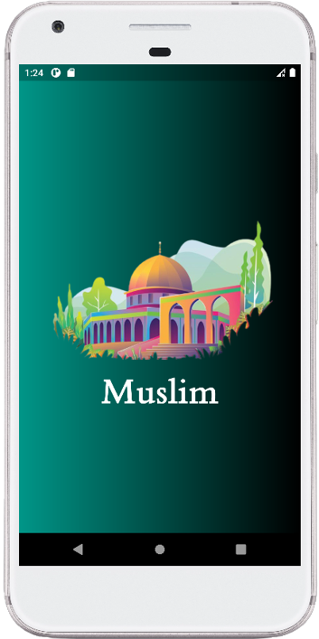
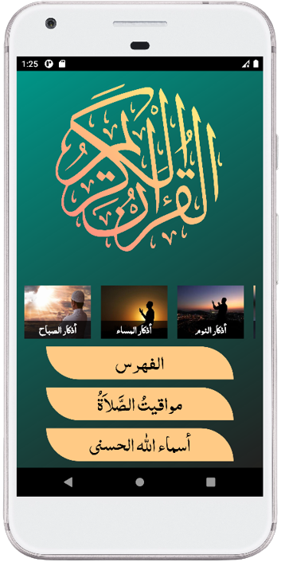
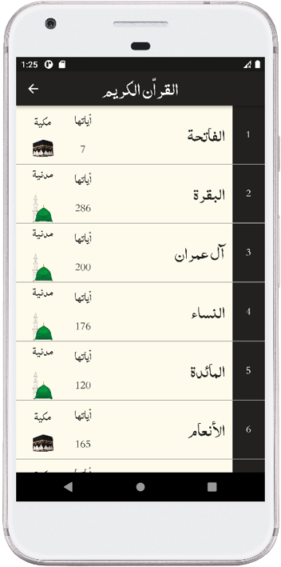
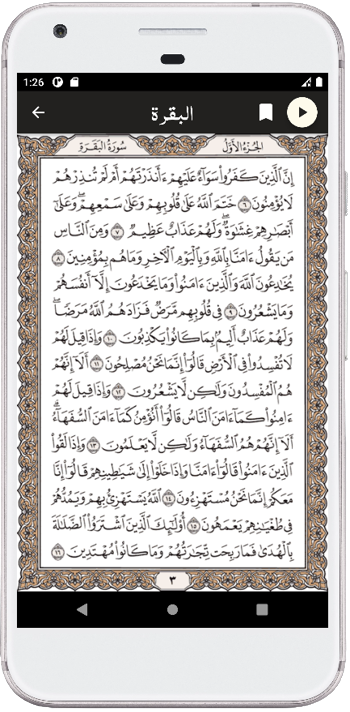
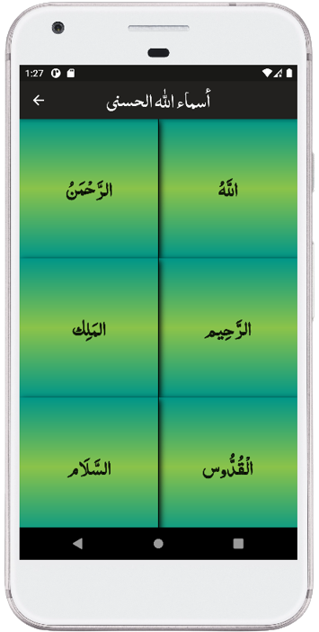
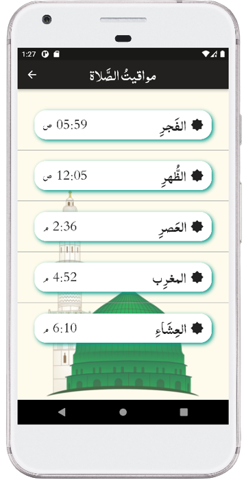

# Muslim-App

A new Flutter project.

## Features
- It Contains the whole quran to read.
- Also You can listen to quran by Sheikh Mashary Rashed El Afasi voice.
- Read Azkar (الصباح, المساء, النوم) , التسابيح , أدعية.
- Hadiths Of The Messenger Mohammed (صل الله عليه و سلم).
- Asmaa Allah El Hosna.
- Prayer Times.
<br>
<br>

## Android development

Build and update the existing app on the single connected Android device:

```powershell
.\tool\run_android_debug.ps1
```

If more than one device is connected, pass its ADB serial:

```powershell
.\tool\run_android_debug.ps1 -DeviceId <serial>
```

The script builds only `android-arm64`, compares the new APK signing certificate with the installed app, then uses `adb install -r` to update `com.example.untitled8` and preserve its data. It refuses to install if the package is missing or its signing key differs; it never uninstalls the app or clears data. After launch, Flutter attaches for hot reload: press `r` to reload, `R` to restart, or `q` to detach.

Use `-AllowFirstInstall` only when intentionally installing the app for the first time; a fresh install has no existing on-device app data to preserve.

The text-based offline Quran reader no longer bundles the old Quran page images. The original image files are retained in the repository, but excluded from the APK.

<br>
<br>

| | ||
| - | - | - |
|  |  | 
|  |  | |
