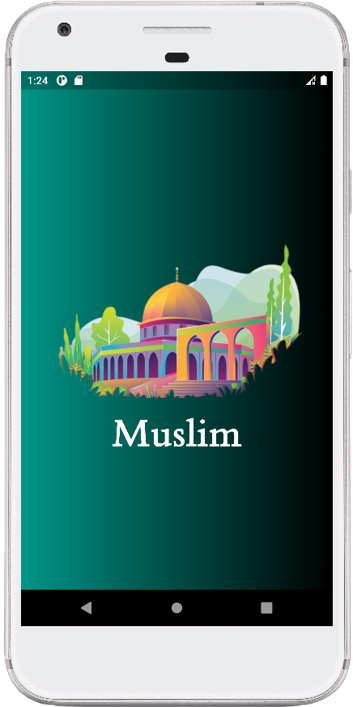
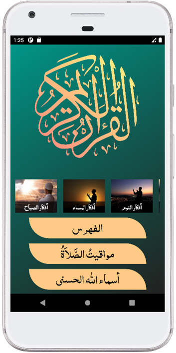
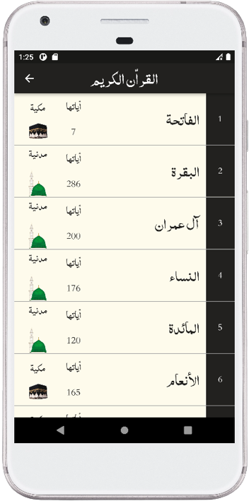
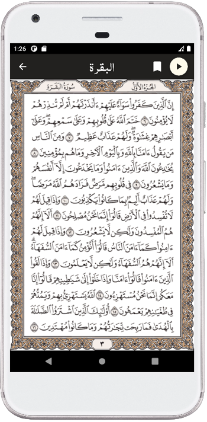
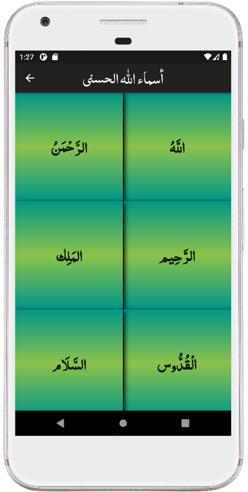
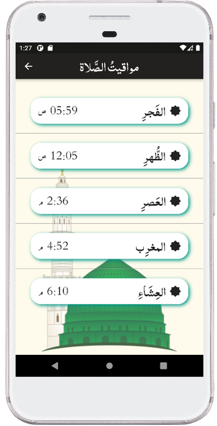

# Muslim-App

A new Flutter project.

## Features
- It Contains the whole quran to read.
- Also You can listen to quran by Sheikh Mashary Rashed El Afasi voice.
- Read Azkar (الصباح, المساء, النوم) , التسابيح , أدعية.
- Hadiths Of The Messenger Mohammed (صل الله عليه و سلم).
- Asmaa Allah El Hosna.
- Prayer Times.
<br>
<br>

## Android development

### Adhan stop controls

While Adhan is playing, its native playback service activates a remote-volume
`MediaSession`. Android routes volume adjustments to that session's
`VolumeProvider`, which stops Adhan and consumes either volume key without
changing the device volume. The session exists only during playback and is
released on stop or completion, preserving normal volume controls otherwise.
The ongoing playback notification retains its stop action as a backup control.
Android documents this remote-volume routing through `MediaSession.setPlaybackToRemote`.

Build and update the existing app on the single connected Android device:

```powershell
.\tool\run_android_debug.ps1
```

If more than one device is connected, pass its ADB serial:

```powershell
.\tool\run_android_debug.ps1 -DeviceId <serial>
```

The script builds only `android-arm64`, compares the new APK signing certificate with the installed app, then uses `adb install -r` to update `com.example.muslim` and preserve its data. It refuses to install if the package is missing or its signing key differs; it never uninstalls the app or clears data. After launch, Flutter attaches for hot reload: press `r` to reload, `R` to restart, or `q` to detach.

Use `-AllowFirstInstall` only when intentionally installing the app for the first time; a fresh install has no existing on-device app data to preserve.

The text-based offline Quran reader uses the bundled Uthmanic text and font. The legacy Quran page images are no longer included in the app assets.

<br>
<br>

| | ||
| - | - | - |
|  |  | 
|  |  | |
